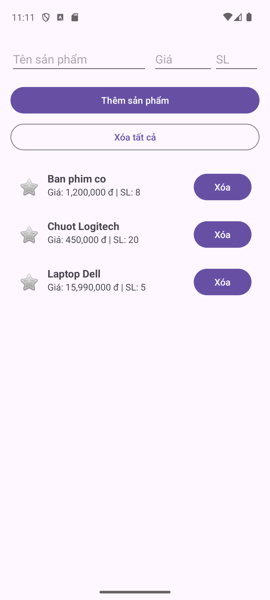
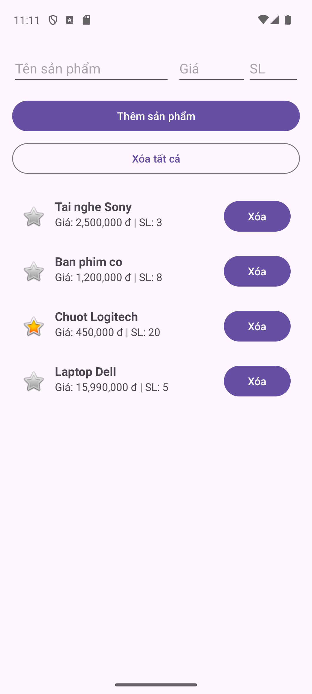

# Lab 07: Room Entity, DAO, Database and Repository

Student: Võ Việt Tiến, 2474802010391
Course: Mobile Application Programming (71ITSE30603), Van Lang University

ProductRoomApp is a small offline product catalog. Products are stored in a local SQLite file through Room, so the list survives app restarts and process death.

## Lab checkpoints

| Lab | What it covers | Tag / commit |
|-----|----------------|--------------|
| 07A | Gradle + KSP setup, `ProductEntity`, `ProductDao` | tag `lab07a` |
| 07B | Thread-safe `AppDatabase`, `ProductRepository`, `ProductViewModel`, RecyclerView UI, main thread debugging | `main` |

## Project structure

```
app/src/main/java/edu/vlu/week07/productroom/
├── data/
│   ├── local/
│   │   ├── AppDatabase.kt        # @Database, double-check locking singleton
│   │   ├── ProductDao.kt         # @Insert, @Update, @Delete, @Query
│   │   └── ProductEntity.kt      # table "products"
│   └── repository/
│       └── ProductRepository.kt  # wraps DAO calls in Dispatchers.IO
└── ui/
    ├── MainActivity.kt           # ViewBinding, observes LiveData
    ├── ProductAdapter.kt         # ListAdapter + DiffUtil
    └── ProductViewModel.kt       # viewModelScope coroutines
```

## Database

- File: `vlu_product_catalog_db` (app internal storage)
- Table `products`: `id` (INTEGER, auto increment), `product_name`, `product_price`, `stock_quantity`, `is_favorite`, `created_at`
- DAO (07A): `insertProduct` (REPLACE on conflict), `deleteProduct`, `getAllProducts()` as `LiveData` ordered by `id DESC`, `getProductById`
- Extra queries (07B): `updateProduct`, `setFavorite`, `count`, `deleteAll`

## Features

- Add a product (name, price, quantity)
- Mark or unmark a product as favorite (star icon)
- Delete one product or clear all
- The list updates by itself through `LiveData`

## Versions

Android Gradle Plugin 9.4.1 (built-in Kotlin), KSP 2.3.12, Room 2.8.5, Lifecycle 2.11.0, Coroutines 1.10.2, minSdk 24.
The handout uses Room 2.6.1 with Kotlin 1.9.20; Room 2.6.1 does not support the Kotlin 2.x / KSP2 toolchain of the current Android Studio, so Room 2.8.5 is used. The Room API used in the code is the same.

## Debugging

See [DEBUG_REPORT.md](DEBUG_REPORT.md) for the main thread crash (Part 4) with the Logcat trace, and the Notes debugging challenge.

## Screenshots

| Product list | After killing and reopening the app |
|---|---|
|  |  |

## How to run

1. Open the project in Android Studio and let Gradle sync.
2. Run the `app` configuration on an emulator (API 26+).
3. To inspect the data: View > Tool Windows > App Inspection > Database Inspector, pick `edu.vlu.week07.productroom`, open `vlu_product_catalog_db`, and run for example `SELECT * FROM products WHERE is_favorite = 1;`.
